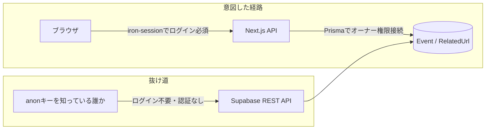

# セキュリティ対応記録（2026-07-29）

## 発端

Supabase から「Table publicly accessible（テーブルが誰でもアクセス可能な状態になっている）」という警告メールが届いたことをきっかけに、プロジェクト全体のセキュリティ監査を実施した。

## 見つかった問題と対応

| # | 深刻度 | 問題 | 対応 | 状態 |
|---|--------|------|------|------|
| 1 | 🔴 Critical | `Event` / `RelatedUrl` テーブルに Row Level Security（RLS）が未設定で、Supabase の自動生成REST APIから認証なしに読み書きできた | RLSを有効化（ポリシーはあえて設定せず、デフォルト全拒否に） | 本番DBに適用済み |
| 2 | 🟡 Medium | `/api/fetch-title` のSSRF対策がホスト名の文字列チェックのみで、DNSリバインディングに弱かった | 実際の名前解決結果を検証するチェックを追加 | コード修正・push済み |

以下、それぞれ詳しく説明する。

---

## 1. Supabase テーブルの公開設定（RLS未設定）

### 何が起きていたか

このアプリは Next.js から Prisma 経由で直接 PostgreSQL（Supabase上）に接続している。アプリ自体は Supabase の SDK や REST API を使っていない。

しかし **Supabase は、`public` スキーマに存在する全テーブルを、使っているかどうかに関わらず自動的に REST API（PostgREST）として公開する**。これは Supabase の仕様であり、コードとは無関係に発生する。

このREST APIは `anon` キー（クライアント向けに配布されることを前提とした鍵）さえあれば呼び出せる。通常はこのアクセスを **RLS（Row Level Security）のポリシー**で制限する設計になっているが、本プロジェクトではテーブル作成時にRLSを有効化していなかった。

つまり、以下のような状態だった。



- 一覧の閲覧（GET）はもともとアプリの設計として認証不要（`middleware.ts` で意図的に公開）なので、読み取りだけなら実害は小さい。
- 問題は **登録・編集・削除（POST/PUT/DELETE）はログイン必須**という設計を、Supabase REST API経由では**丸ごとバイパスできてしまう**こと。ログインなしで誰でもイベントの改ざん・削除が可能な状態だった。

### 対応内容

`Event` と `RelatedUrl` の両テーブルに対して、ポリシーを一切定義せずに RLS だけを有効化した。

```sql
ALTER TABLE "Event" ENABLE ROW LEVEL SECURITY;
ALTER TABLE "RelatedUrl" ENABLE ROW LEVEL SECURITY;
```

ポリシーがゼロの状態でRLSを有効化すると、**そのテーブルへのアクセスはデフォルトで全ロール拒否**になる（＝Supabase REST API 経由のアクセスは完全にブロックされる）。

一方で、このアプリの Prisma（`DATABASE_URL`）はテーブルの**オーナー権限**で直接PostgreSQLに接続しており、PostgreSQLの仕様上**テーブルオーナーはRLSの制限を受けない**。そのため、アプリの動作には一切影響がない。

適用場所:
- マイグレーションファイル: `prisma/migrations/20260729043429_enable_row_level_security/migration.sql`
- 本番のSupabase DBには `pg` ドライバで直接接続し、その場でSQLを実行して即時反映（コミット `b271ced` より前に適用済み）
- 適用後、`relrowsecurity = true` であること、およびアプリ用の接続でテーブルの行数が問題なく取得できることを確認済み

RLSの仕組み自体について詳しくない場合は [`row-level-security.md`](./row-level-security.md) を参照。

### 今後の注意点

**新しくテーブルを追加したら、必ず同様にRLSを有効化すること。** これを忘れると、また同じ形で「テーブルが公開されている」状態に戻ってしまう。`CLAUDE.md` にもこの注意点を追記済み。

### 未対応で残っている点（別問題）

`prisma/migrations/` には最初の `init` マイグレーションしか記録がなく、`RelatedUrl` テーブル作成の記録がない（開発時に `prisma db push` で追加され、マイグレーション履歴に取り込まれていない）。これは今回のセキュリティ対応とは別の"マイグレーション履歴のドリフト"問題であり、今回は手を付けていない。将来 `prisma migrate deploy` を使う際に失敗する可能性がある点は認識しておくこと。

---

## 2. fetch-title API のDNSリバインディング対策

### 背景

`/api/fetch-title` はユーザーが指定したURLに実際にサーバーサイドから `fetch()` してタイトルを取得する機能。この手のAPIは典型的な **SSRF（Server-Side Request Forgery）** のリスクを持つ。

以前の修正（コミット `9303d83`）で、HTTPリダイレクトを悪用した回避策（`redirect: "follow"` → `"error"`）はすでに対応済みだった。今回の監査で、**別の抜け道**が残っていることが分かった。

### 何が抜けていたか

既存の `isSafeUrl()` は、URLの**ホスト名の文字列**を正規表現でチェックし、`127.0.0.1` や `192.168.x.x` のような明らかにプライベートなIPやホスト名を弾いていた。

しかし、これは「ホスト名の見た目」しか見ていない。例えば `example-cdn.com` のような一見無害なドメイン名が、DNSの設定次第で実際には `127.0.0.1` や社内ネットワークのIPに**名前解決される**ケースを想定していなかった。攻撃者が自分の管理するドメインでこれをやれば、文字列チェックを素通りしてプライベートIPにリクエストを送らせられる（**DNSリバインディング**と呼ばれる手法）。

検証として、127.0.0.1 に解決される実在の検証用ドメイン `localtest.me` を対象に、修正前のロジックだと通ってしまうこと・修正後は正しくブロックされることを確認済み。

### 対応内容

`src/app/api/fetch-title/route.ts` に、実際の名前解決結果を検証する `resolvesToPrivateAddress()` を追加した。

- `node:dns/promises` の `lookup()` で、fetch実行前にホスト名を実際に名前解決する
- 得られた全てのIPアドレス（IPv4/IPv6、複数ある場合は全件）をプライベートIP判定にかける
- 1つでもプライベート/ループバック/リンクローカル/CGNATなどに該当すればリクエストを拒否する
- ついでに、既存のプライベートIP判定自体も強化（CGNAT `100.64.0.0/10`、IPv4-mapped IPv6 `::ffff:x.x.x.x`、IPv6 unspecified `::` などを追加）

なお、「名前解決した瞬間」と「実際に `fetch()` が内部で再度名前解決する瞬間」の間にDNSの応答が切り替わる、という極小の時間差（TOCTOU）は理論上残るが、静的な悪意あるDNSレコードによる攻撃は防げる。この対応で十分と判断した。

コミット: `b271ced`（コード修正）
