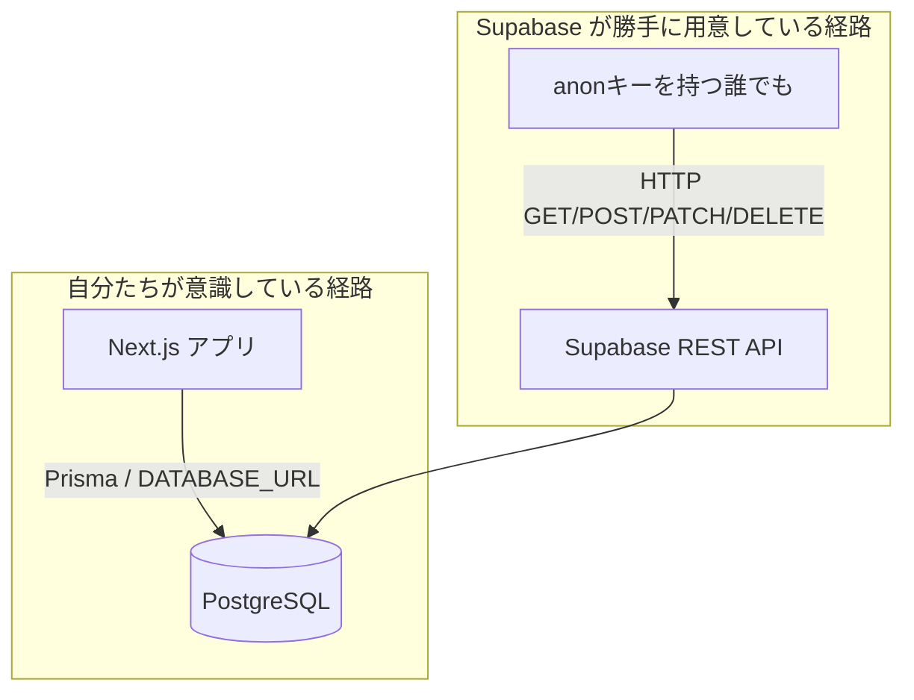
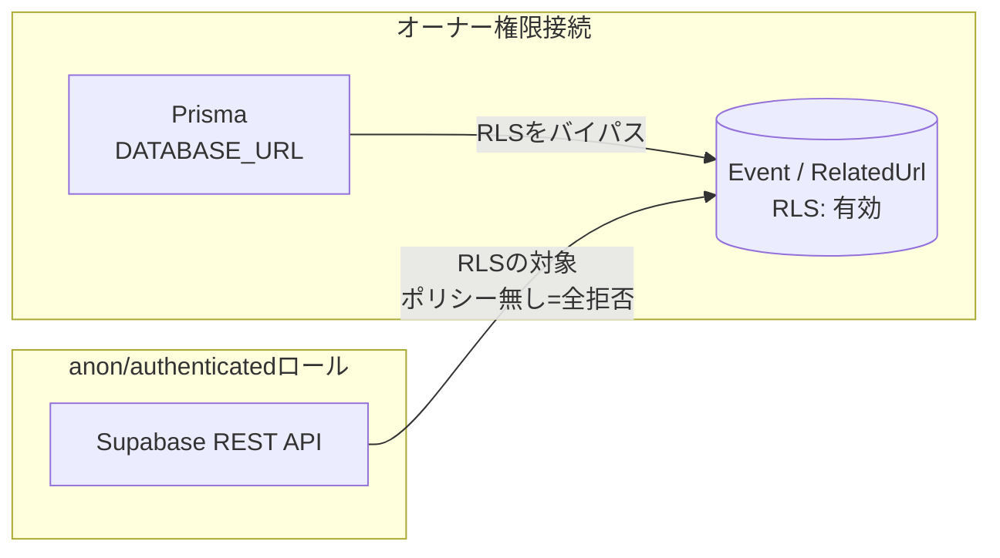

# Row Level Security（RLS）とは何か

このドキュメントは、[`2026-07-29-security-fixes.md`](./2026-07-29-security-fixes.md) で行った対応の前提知識として、RLSそのものを理解するためのもの。PostgreSQL / Supabase の一般的な仕組みの説明であり、本プロジェクト固有の話ではない部分も含む。

## 1. そもそもの問題: Supabase は「テーブルを作っただけで」外部公開される

まず前提として、RLSの話をする前に「なぜRLSが必要なのか」を理解する必要がある。

普通にPostgreSQLだけを使っている場合、テーブルへのアクセス経路は「アプリがDBに接続する」経路だけしかない。アプリのコード（今回でいう Next.js の API Route）がゲートキーパーになっていて、そこで認証チェックをすればそれで十分だった。

**Supabase はここに、もう一つの経路を勝手に追加する。**

Supabaseは「BaaS（Backend as a Service）」として、`public` スキーマに作られたテーブルを**自動的にREST API（内部的には PostgREST というミドルウェアが担当）として公開**する。これはSupabaseの目玉機能の一つで、フロントエンドから直接 `https://xxxx.supabase.co/rest/v1/Event` のようなURLを叩いてDBを操作できる、というのがウリになっている。



このアプリはPostgREST機能を**一切使っていない**（Prismaで直接繋いでいる）が、それとは関係なく **テーブルが `public` スキーマに存在する限り、このAPIは有効**。そしてこのAPIを呼ぶための `anon` キーは、本来「クライアント（ブラウザ）に配布されて当然の鍵」として設計されている（Supabaseを使う別の使い方＝フロントエンドから直接DBを叩く構成、を前提にした鍵）。つまり **`anon` キーは"秘密"ではない**。

ここで唯一の防波堤になるのが RLS。

## 2. RLSとは

RLS（Row Level Security）は PostgreSQL 自体が持っている機能で、「**テーブル単位ではなく、行（レコード）単位でアクセス制御をかける**」仕組み。

- 通常の `GRANT` / `REVOKE` は「このロールはこのテーブルを読める/読めない」というテーブル単位の権限
- RLSは「このロールは、この条件に一致する**行だけ**読める/書ける」という行単位の権限

例えば「ユーザーは自分が作ったレコードしか見えない」「管理者は全部見える」といった制御を、アプリのコードではなく **DB自身に強制させる**ことができる。

### 有効化とポリシーの関係（ここが最重要ポイント）

RLSには2段階ある。

1. **`ENABLE ROW LEVEL SECURITY`** でテーブルに対してRLSを「有効化」する
2. **`CREATE POLICY`** で「どの条件なら許可するか」を個別に定義する

そして最も重要なルール:

> **RLSを有効化した時点で、そのテーブルへのアクセスは「ポリシーが無ければ全拒否」になる。**

つまり、ポリシーを1つも書かなくても、`ENABLE ROW LEVEL SECURITY` を実行するだけで「デフォルト全拒否」という立派なアクセス制御になる。今回の対応（`Event` / `RelatedUrl` テーブル）はまさにこのパターンで、意図的にポリシーを追加せず、「Supabase REST API経由では何も見えない・書けない」状態にした。

```sql
-- これだけで「ポリシーが無い＝全拒否」になる
ALTER TABLE "Event" ENABLE ROW LEVEL SECURITY;
```

もし将来、「ログイン中のユーザーには読み書きを許可したい」のように**部分的に**開放したくなったら、ポリシーを追加する。例えば（あくまで一般的な書き方の例）:

```sql
-- 例: authenticated ロールには全件の読み取りだけ許可する場合
CREATE POLICY "authenticated_can_read_events"
  ON "Event"
  FOR SELECT
  TO authenticated
  USING (true);
```

`USING` 句が「どの行を対象にするか」の条件。`true` なら全行が対象（＝全部読める）。`WITH CHECK` 句を使うと INSERT/UPDATE 時に「この条件を満たすデータしか書き込めない」という制限もかけられる。今回のプロジェクトでは、こうしたポリシーは一切追加していない（＝完全遮断のまま）。

## 3. なぜ「Prismaの接続」はRLSの影響を受けないのか

RLSは「テーブルのオーナー（所有者）」には**適用されない**、というPostgreSQLの仕様がある（`FORCE ROW LEVEL SECURITY` を明示的に付けない限り）。

このプロジェクトの `DATABASE_URL` は、Supabaseのプロジェクト作成時に発行される接続文字列で、テーブルを実際に作成したロール（＝テーブルオーナー）としてPrismaが直接PostgreSQLに接続している。そのため、

- **Prisma経由のアクセス（＝アプリの通常の動作）**: オーナー権限なのでRLSは素通り。今まで通り動く
- **Supabase REST API経由のアクセス（`anon` / `authenticated` ロール）**: オーナーではないのでRLSの制限をフルに受ける。ポリシーが無いので全拒否

という綺麗な切り分けが実現できる。



これが確認できているのは、対応後に実際に本番DBへPrisma接続と同じ経路（オーナー権限）でクエリを実行し、`Event` テーブルの行数が問題なく取得できたことを確認しているため。

## 4. よくある誤解

- **「RLSはアプリ側の認証（今回でいうログイン機能）の代わりになる」** → 違う。今回のように「ポリシー無しで全拒否」にする使い方は、あくまで**Supabaseが自動公開してしまうAPIを塞ぐため**のもの。アプリ自体の認可ロジック（iron-sessionでのログインチェック）とは別レイヤーの話。
- **「RLSを有効化したらアプリが動かなくなるのでは」** → テーブルオーナー権限で接続しているなら影響しない（今回のケース）。ただし、もしアプリが `anon` / `authenticated` ロールでDB接続している構成（Supabase Auth を使った典型的な構成など）だと、RLSを有効化した第間にポリシー不足でアプリ自体のクエリも弾かれるようになるので要注意。今回のプロジェクトはPrismaで直接オーナー権限接続しているため該当しない。
- **「anonキーを非公開にすればいい」** → `anon` キーは設計上「公開されて当然」の鍵。隠す方向で対策するのは誤り。正しい対策は常にRLS側。

## 5. 現在の状態の確認方法

Supabase の SQL Editor、または直接 `psql` などで以下を実行すると、RLSが有効かどうか・ポリシーが何個あるかを確認できる。

```sql
-- RLSが有効かどうか
SELECT relname, relrowsecurity
FROM pg_class
WHERE relname IN ('Event', 'RelatedUrl');

-- 設定されているポリシー一覧（今は0件のはず）
SELECT tablename, policyname
FROM pg_policies
WHERE tablename IN ('Event', 'RelatedUrl');
```

## 参考リンク

- [Supabase公式: Row Level Security](https://supabase.com/docs/guides/database/postgres/row-level-security)
- [PostgreSQL公式: Row Security Policies](https://www.postgresql.org/docs/current/ddl-rowsecurity.html)
